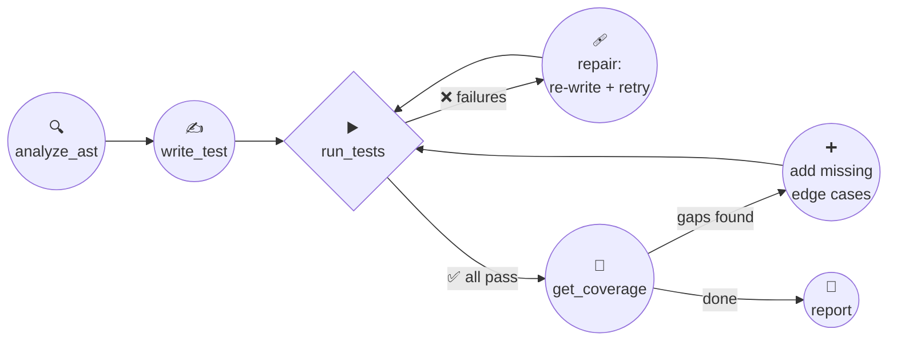

<div align="center">

# 🤖 TestGen

**An agentic test engineer that writes, runs, and repairs your Python tests — until they pass.**

[](https://www.python.org)
[](LICENSE)
[](https://docs.astral.sh/ruff/)
[](tests)
[](#quickstart)

*One-shot LLM output is a coin-flip. TestGen makes the model prove its work.*

</div>

---

## 💡 The idea

Most "AI test generators" do this:

```
your code ──▶ LLM ──▶ 🤞──── hope the tests work ────▶ ✍️ file
```

**TestGen doesn't hope. It verifies.** It's a full agent loop with native **tool calling**
— the LLM autonomously decides to inspect your code's AST, write a test module, execute
it with `pytest`, measure line coverage, read the failure tracebacks, and **rewrite its
own tests until they pass** or the iteration budget is spent.

<div align="center">



*Every arrow is a real tool call the model chose to make — not a hardcoded pipeline.*

</div>

---

## 🛠️ The agent's toolbox

The model sees these four tools through Ollama's function-calling API and decides when to use each:

| Tool | What it does | Returns to the agent |
|---|---|---|
| 🔍 `analyze_ast` | AST-parses the target file | functions, params, type hints, defaults, **raised exception types** |
| ✍️ `write_test` | strips markdown fences, **syntax-validates**, writes **only** inside the `.testgen` sandbox | the written path (or a reject-with-error so it can retry) |
| ▶️ `run_tests` | executes `pytest` in the source dir | passed/failed/error counts + **real tracebacks** to read |
| 📐 `get_coverage` | runs under `coverage.py` | line-coverage % + the **exact uncovered line numbers** |

> 🛡️ **Guardrails baked in:** sandboxed writes (source file is never touched), strip-fenced
> LLM output, blind-exception-proof tool registry, hard iteration budget, machine-readable
> `report.json` for every run.

---

## ✨ The receipts — real agent runs

*Every row below was generated end-to-end by the agent (model: `gemma4:31b-cloud`), tests actually executed:*

| Target | What makes it hard | Tests generated | Line coverage |
|---|---|---:|---:|
| `add` *(v1's original file)* | — | 7 | **100%** |
| `circle_area` | `ValueError` edge case, float precision | 4 | **100%** |
| `binary_search` + `levenshtein` | 4 branch combos, DP short-circuits | 10 | **100%** |
| `BankAccount` class | stateful class, 5 exception paths, stateful `transfer` | 8 | **100%** |
| `retry` / `with_timeout` *(async)* | coroutine factories, `IsolatedAsyncioTestCase`, exception chaining | 8 | **100%** |

*Every fixture complex-tier run passed first-shot — and the agent doesn't just claim success:
in the async run it **diagnosed its own `RuntimeWarning`s** (coroutines created but never
awaited after an early-rejection path) and explained in its final summary why that's the
correct behavior for that specific test case.*

A sample of what the agent actually wrote (from the `bank.py` run):

```python
def test_transfer_insufficient_funds(self):
    src = BankAccount("Alice", 20.0)
    dst = BankAccount("Bob", 50.0)
    with self.assertRaises(ValueError):
        transfer(src, dst, 30.0)
    self.assertEqual(src.balance, 20.0)   # 💡 state-consistency check it invented
    self.assertEqual(dst.balance, 50.0)
```

---

## 🚀 Quickstart

```bash
git clone https://github.com/minamaher005/CLI_Test_Generator_proj.git
cd CLI_Test_Generator_proj/cli-testgen

python -m venv .venv && .venv\Scripts\activate    # (Linux/macOS: source .venv/bin/activate)
pip install -e ".[dev]"

cp .env.example .env        # → add your OLLAMA_API_KEY
```

```bash
# 🧠 full agentic run (needs OLLAMA_API_KEY)
testgen path/to/your_module.py

# 🆓 fully offline deterministic demo — no API key, same tool loop
testgen path/to/your_module.py --provider mock
```

<div align="center">

```text
 ┌──────────────────── TestGen ─────────────────────┐
 │ provider=ollama model=gemma4:31b-cloud iter=5    │
 └──────────────────────────────────────────────────┘
  → tool: analyze_ast        ✓
  → tool: write_test         ✓
  → tool: run_tests          ✓
  → tool: get_coverage       ✓
 ┌──────────────── TestGen Agent ───────────────────┐
 │ SUCCESS — passed=4 failed=0 errors=0             │
 └──────────────────────────────────────────────────┘
  Tests: 4 passed ▸ Coverage: 100.0% ▸ 5 iterations
```

</div>

### ⚙️ Flags

| Flag | Default | Purpose |
|---|---|---|
| `--provider` | `ollama` | `ollama` (live LLM) · `mock` (offline scripted agent) |
| `--model` | `gemma4:31b-cloud` | any Ollama model |
| `--max-iterations` | `5` | hard budget for the repair loop |
| `--coverage-threshold` | `80` | % the agent should chase |
| `--no-coverage` | off | drop the coverage tool |
| `--outdir` | `.testgen` | sandbox for `*_test.py`, `coverage.json`, `report.json` |
| `--verbose / -v` | off | full tool payloads as they happen |

---

## 🏗️ Architecture

```
src/testgen/
├── cli.py                  # thin orchestrator: flags → validation → wiring
├── config.py               # env-driven model/provider/limits
├── agent/
│   ├── core.py             # ⭐ the observe → think → act loop
│   ├── state.py            # conversation history + tool trace
│   └── prompts.py          # agent role + tool-usage policy
├── tools/                  # the agent's hands
│   ├── base.py             # Tool protocol + registry (survives any tool crash)
│   ├── source_analysis.py  # analyze_ast
│   ├── test_writer.py      # write_test (sandboxed)
│   ├── test_runner.py      # run_tests
│   └── coverage.py         # get_coverage
├── llm/
│   ├── ollama_provider.py  # native tool calling
│   └── mock_provider.py    # same loop, zero network (demos + CI)
├── validation/ast_validator.py   # input gate: readable, parses, has functions
└── reporting/report.py     # rich console summary + report.json
```

<details>
<summary><b>🎯 Design decisions worth stealing</b></summary>

- **AST over regex** — both the input gate and `analyze_ast` use Python's `ast` module;
  the agent sees param names, defaults, annotations, and *raised exception types*.
- **Structured observations** — every tool returns JSON (`ok`, counts, paths, tracebacks);
  the model never parses human-facing logs to reason.
- **Bounded autonomy** — a max-iteration budget stops infinite repair spirals and still
  writes a partial report.
- **Deterministic replay** — the mock provider walks the *identical* tool loop offline,
  so demos and CI never depend on an LLM or a network.
- **Fail-open tooling** — a tool crash becomes an observation the agent can react to,
  not a stack trace that kills the run.
- **Dogfooding** — the repo's own tests + CI exercise the full loop without an API key.

</details>

<details>
<summary><b>v1 vs v2 — why the rewrite</b></summary>

| v1 *(single-shot pipeline)* | v2 *(this package)* |
|---|---|
| One-shot prompt → file written blind | Agent loop with native tool calling |
| Generated tests **never executed** | Tests executed; tracebacks fed back for repair |
| No verification of any kind | Real line-coverage measurement per run |
| Hardcoded model, misleading logs | Config-driven, multi-provider, clean output |
| 5-file script | Packaged CLI, 15 tests, ruff-clean, CI |

</details>

---

## 🧪 Development

```bash
python -m pytest tests -q     # 15 tests · no network · no API key
ruff check .                  # lint
testgen tests/fixtures/add.py --provider mock   # local smoke run
```

## 🗺️ Roadmap

- [x] Run + document the async fixture (`aiotasks.py`) — exercising the live repair loop
- [ ] Capture a demo GIF of the agent repairing a failing test
- [ ] `parametrize` expansion & property-based test hooks
- [ ] Alternative providers (OpenAI-compatible endpoints) behind the same `LLMProvider` protocol
- [ ] `--diff` mode: generate tests for the files a PR touched
- [ ] HTML coverage + PR comment publishing

---

<div align="center">

**Built with** Ollama function-calling · pytest · coverage.py · rich · argparse

⭐ *If TestGen saved you a coffee's worth of test-writing, a star on the repo means a lot.*

</div>
